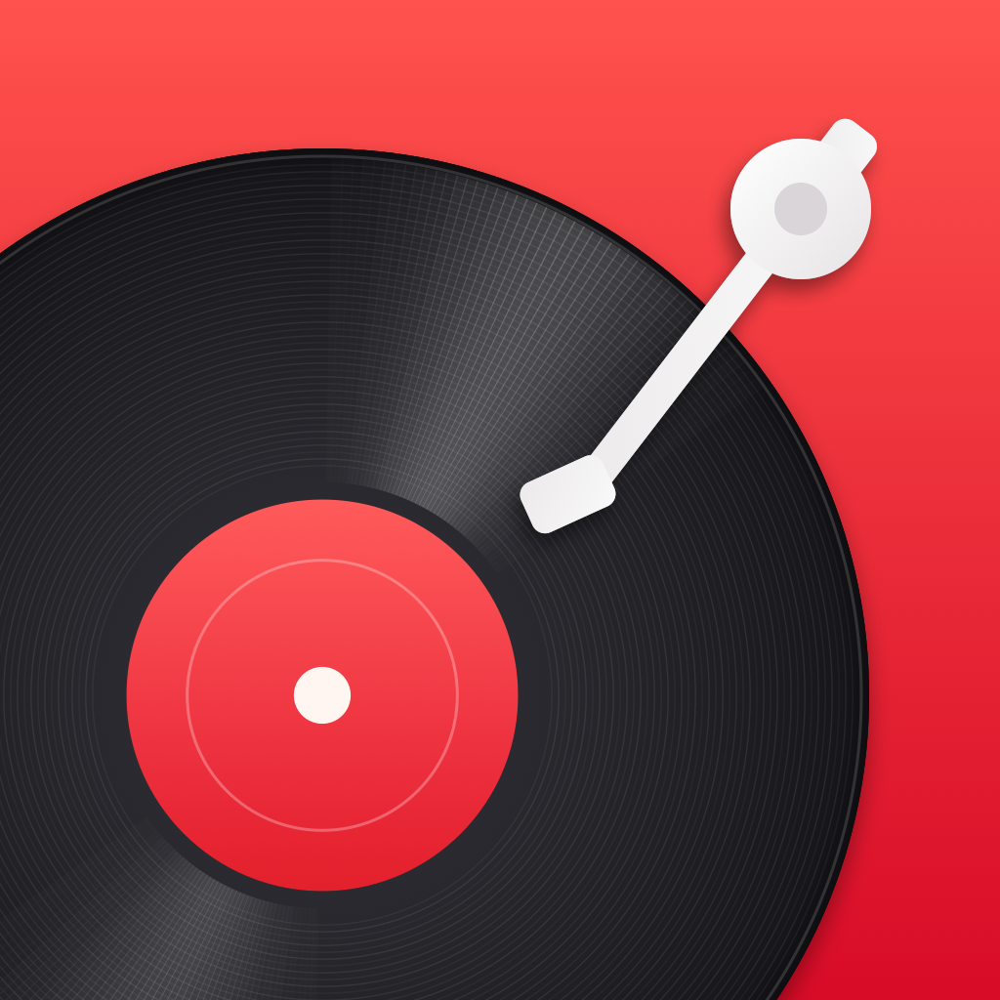
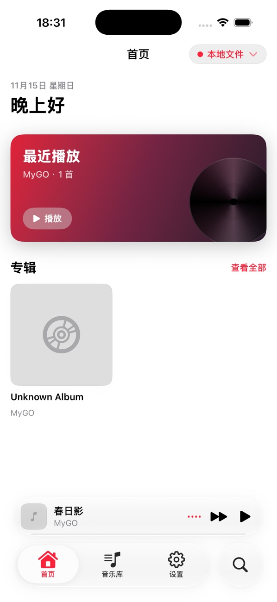
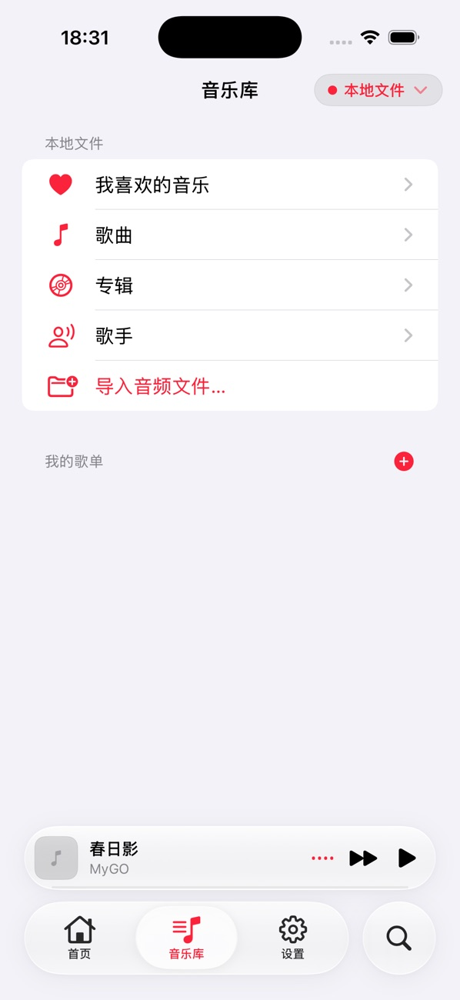
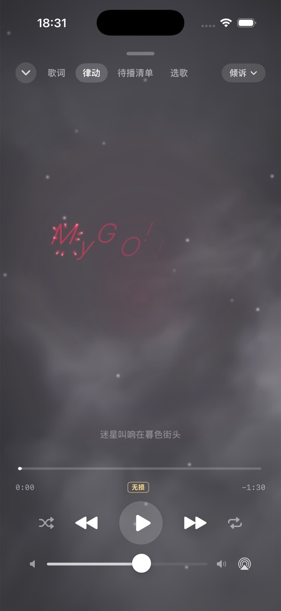
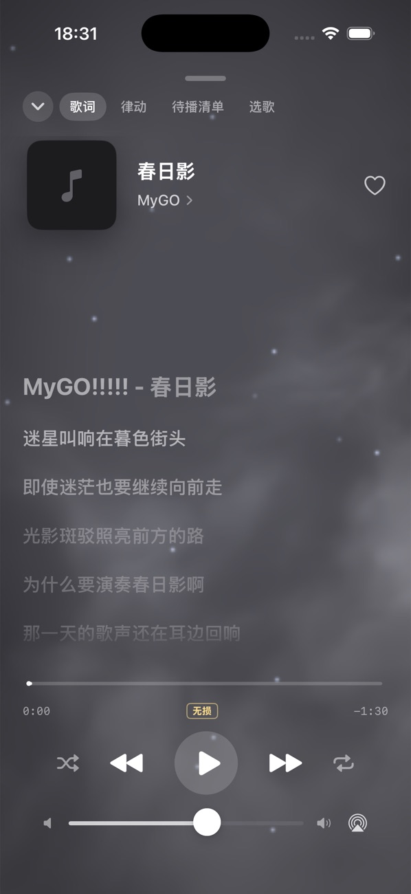

<p align="center">
  
</p>

<h1 align="center">MyGo Music iOS</h1>

<p align="center">Let music and lyrics flow seamlessly in the palm of your hand.</p>

<p align="center">
  <a href="https://github.com/mojieniko/mygo-music-ios/releases/latest"></a>
  <a href="https://github.com/mojieniko/mygo-music-ios/blob/main/LICENSE"></a>
  
  
</p>

<p align="center">
  <a href="https://github.com/mojieniko/mygo-music-ios">简体中文</a> | <b>English</b>
</p>

<p align="center">
  An unofficial iOS / iPadOS port of MyGo Music. Bringing the plugin ecosystem, local music library, Apple Music-style Now Playing experience, and live lyrics to Apple mobile devices, independently maintained by the community.
</p>

## Screenshots

<p align="center">
  
  
  
  
</p>
<p align="center"><sub>iPhone Preview · Home, Local Library, Now Playing, and Lyrics</sub></p>

## Key Features

### Playback & Visual Experience
- **Apple Music-Style Now Playing UI**: Full-screen album artwork view, soft adaptive artwork-tinted gradient backdrop, fluid cover-to-lyrics transitions, and high-stiffness spring physics for expanding and interactively dismissing to the mini player bar.
- **Thoughtful Gestures & Navigation**: Swipe horizontally on the mini player bar to skip tracks, marquee scrolling for long titles, pull-to-refresh across artist/album/playlist pages, swipe actions on track rows, and multi-select batch operations.
- **Synced Lyrics**: Line-by-line and word-by-word lyrics synchronization with translation alignment, instant scrub-to-seek calibration, and real-time Lock Screen lyrics display.

### High-Resolution Audio & Playback Controls
- **Transparent Audio Signal Path**: Dynamic lossless format badges (FLAC, MP3, WAV, AAC, M4A, etc.), real-time audio signal path inspection, and independent audio quality settings for Wi-Fi and Cellular networks.
- **Complete Listening Capabilities**: Gapless playback, single-track and full-album offline downloads with background keep-alive, sleep timer, `.spokenAudio` podcast mode with resume-position memory, hot comments, and saving the current queue as a playlist.

### Deep iOS / iPadOS Integration
- **System Media Integration**: Full support for Dynamic Island, Lock Screen, and Control Center controls with tap-to-open app routing.
- **Local Library & Files Integration**: Automatically scans shared folders in the iOS Files app and supports opening audio files or `.zip` plugin archives directly from other apps.
- **System Shortcuts**: Spotlight search playback recovery, Home Screen Quick Actions, global external keyboard shortcuts (`⌘P`, `⌘←`, `⌘→`, `⌘F`), portrait lock on iPhone, and full multi-orientation support on iPad.

### Plugin Ecosystem & Personalization
- **Native Plugin Engine**: Powered by JavaScriptCore and compatible with the MyGo Music plugin ecosystem for custom streaming sources and web sign-in; available content depends entirely on user-installed plugins.
- **Appearance Customization**: Light, Dark, and System appearance modes, 5 accent color presets, and one-tap alternate app icon switching (**MyGo Music / Apple Music**) inside **Settings → Appearance**.

## Download & Sideloading

Download the latest `MyGoMusic.ipa` from [Releases](https://github.com/mojieniko/mygo-music-ios/releases/latest) (requires **iOS 16.0 / iPadOS 16.0** or later). Since the app is not distributed on the App Store, install it via any of the sideloading methods below:

### Option 1: TrollStore (Recommended, Permanent Signing)
For devices supporting [TrollStore](https://github.com/opa334/TrollStore) (iOS 16.0 – 16.6.1 / 17.0 or jailbroken devices):
1. Download the latest `MyGoMusic.ipa` on your iPhone or iPad.
2. Open the system Share sheet and install directly with **TrollStore** — no 7-day re-signing required.
3. If app icon or Dynamic Island tap caching occurs after an update, open **TrollStore → Settings → Refresh App Registrations**.

### Option 2: Desktop Sideloading Tools (Non-Jailbroken, iOS 16+)
For stock iOS / iPadOS devices (free Apple IDs require refreshing every 7 days; paid Apple Developer accounts last 1 year):

- **Sideloadly (Windows / macOS, Easiest Setup)**
  1. Install [Sideloadly](https://sideloadly.io/) on your computer and connect your iPhone / iPad via USB.
  2. Drag `MyGoMusic.ipa` into Sideloadly, enter your Apple ID, and click **Start**.
  3. Before the first launch, trust your certificate in **Settings → General → VPN & Device Management**, and enable **Settings → Privacy & Security → Developer Mode** if prompted.
- **AltStore / SideStore (Automated Refresh)**
  1. Set up [AltStore](https://altstore.io/) or [SideStore](https://sidestore.io/) on your device following their official guides.
  2. Save `MyGoMusic.ipa` to the Files app, open AltStore / SideStore → **My Apps**, and tap `+` to install (SideStore supports on-device refreshes without a computer).
- **Other Signers (Feather, ESign, etc.)**
  - Import `MyGoMusic.ipa` and sign with your own certificate.

> [!TIP]
> When re-signing with a sideloading tool, keep the default Bundle ID (`com.egoist.mygomusic.ios`) or allow the tool to preserve entitlements so Dynamic Island tap-to-open, in-app icon switching, and file opening associations work properly.

## Build from Source

Requires macOS with Xcode installed:

```bash
git clone https://github.com/mojieniko/mygo-music-ios.git
cd mygo-music-ios
```

- **Run in Xcode**: Open `MyGoMusic.xcodeproj`, select your Signing Team under **Signing & Capabilities**, and run on a device or simulator.
- **Build IPA via CLI**:
  ```bash
  ./build-ipa.sh
  ```
- **Run Core Verifier & Unit Tests**:
  ```bash
  swift run MyGoMusicVerifier && swift test
  ```

## Disclaimer

This project is a community-maintained iOS / iPadOS port of [MyGo Music](https://github.com/egoist/mygo-music) and is not affiliated with the upstream author or any music streaming service. All playable content is provided by user-configured plugins or local audio files.

## License

Licensed under [AGPL-3.0](./LICENSE).
