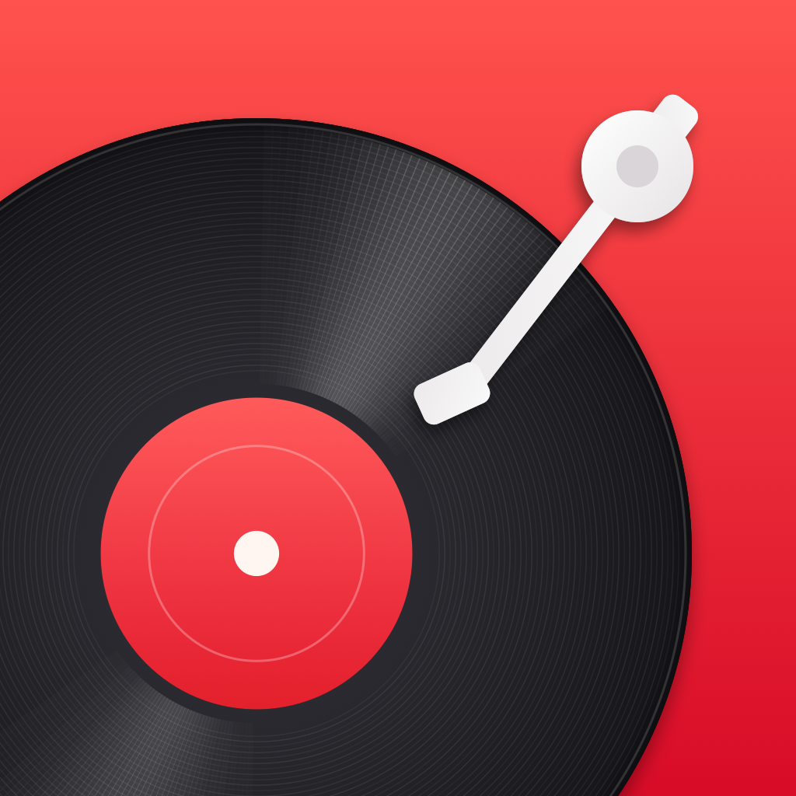

<p align="center">
  
</p>

<h1 align="center">MyGo Music iOS</h1>

<p align="center">让音乐与歌词，在掌心继续流动。</p>

<p align="center">
  <a href="https://github.com/mojieniko/mygo-music-ios/releases"></a>
  <a href="https://github.com/mojieniko/mygo-music-ios/blob/main/LICENSE"></a>
  
</p>

<p align="center">
  MyGo Music 的非官方 iOS / iPadOS 移植版。把插件生态、本地音乐与歌词体验带到 Apple 移动设备，由社区独立维护。
</p>

## 界面预览

<p align="center">
  
  
</p>
<p align="center">
  
  
</p>
<p align="center"><sub>iPhone 17 Pro 模拟器截图 · 展示本地音乐界面</sub></p>

## 为音乐而生

- **插件扩展**：连接 MyGo Music 插件生态，按需拓展音乐体验；可用内容取决于自行配置的插件。
- **本地聆听**：导入并播放设备中的音乐，让个人曲库随时可听。
- **歌词相伴**：跟随播放查看歌词，也可在歌词页面浏览并定位进度。
- **贴合 iOS**：为 iPhone 与 iPad 打造，融入系统外观与轻盈流畅的交互。

## 下载

前往 [Releases](https://github.com/mojieniko/mygo-music-ios/releases/latest) 获取最新版本。最低系统要求为 **iOS 17**。安装包采用 Ad Hoc 签名时，通常需要使用自己的开发者签名或侧载工具重新签名后安装。

## 从源码运行

需要 macOS 与 Xcode。克隆仓库后打开 `MyGoMusic.xcodeproj`，选择模拟器或已配置签名的设备运行。

```bash
git clone https://github.com/mojieniko/mygo-music-ios.git
cd mygo-music-ios
open MyGoMusic.xcodeproj
```

## 项目关系

本项目是 [MyGo Music](https://github.com/egoist/mygo-music) 的社区 iOS / iPadOS 移植，与上游作者及任何音乐服务平台均无隶属或官方合作关系。音乐内容由用户自行配置的插件或本地文件提供。

## 许可

本项目以 [AGPL-3.0](./LICENSE) 许可发布。
