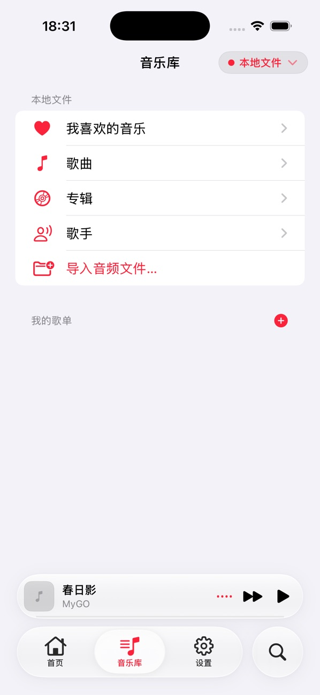
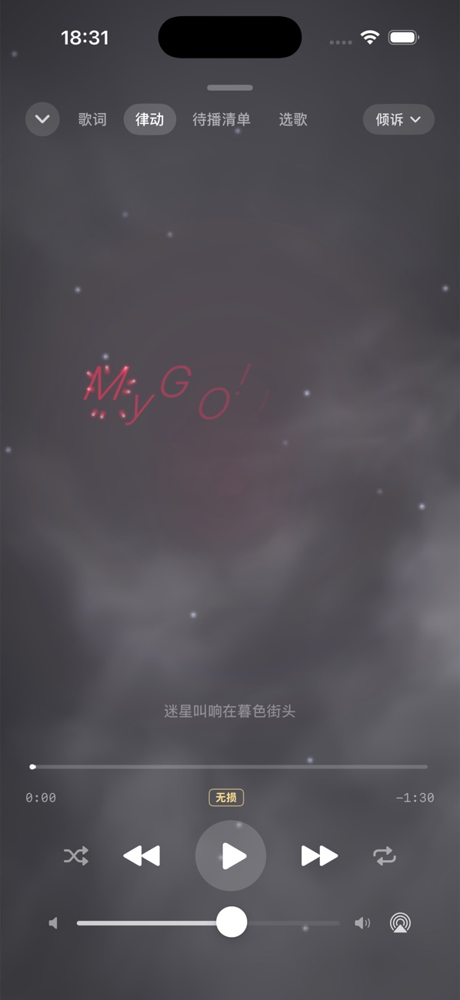

<p align="center">
  
</p>

<h1 align="center">MyGo Music iOS</h1>

<p align="center">让音乐与歌词，在掌心继续流动。</p>

<p align="center">
  <a href="https://github.com/mojieniko/mygo-music-ios/releases/latest"></a>
  <a href="https://github.com/mojieniko/mygo-music-ios/blob/main/LICENSE"></a>
  
  
</p>

<p align="center">
  <b>简体中文</b> | <a href="./README.en.md">English</a>
</p>

<p align="center">
  MyGo Music 的非官方 iOS / iPadOS 移植版。将插件生态、本地曲库、Apple Music 级大封面与歌词体验带到 Apple 移动设备，由社区独立维护。
</p>

## 界面预览

<p align="center">
  
  
  
  
</p>
<p align="center"><sub>iPhone 界面预览 · 展示首页、本地音乐库、大封面播放页与歌词视图</sub></p>

## 核心特性

### 播放与视觉体验
- **Apple Music 风格播放页**：全屏大封面界面、专辑主色柔和渐变背景、封面与歌词丝滑过渡动画，以及基于高刚度弹簧的底栏展开 / 跟手下拉收起交互。
- **高效交互细节**：迷你播放栏支持左右滑动切歌与长标题跑马灯滚动；歌手、专辑与歌单详情页支持全站下拉刷新、歌曲列表左右滑动快捷操作及多选批量管理。
- **歌词相伴**：精准逐行 / 逐字歌词同步与翻译对齐，支持拖动进度即时校准、歌词页快速定位播放及锁屏实时歌词显示。

### 高规格音频与播放控制
- **音频质量与透明路径**：动态展示当前曲目音频格式徽标（FLAC / MP3 / WAV / AAC / M4A 等）与实时音频信号路径，支持 Wi-Fi 与蜂窝网络独立音质策略。
- **完整听歌与播客能力**：支持无缝切歌（Gapless）、单曲 / 专辑离线下载与后台保活、睡眠定时、播客 `.spokenAudio` 语音模式与断点续播、热评浏览以及将待播清单保存为歌单。

### 深度融入 iOS / iPadOS
- **系统媒体联动**：完整支持灵动岛、锁屏界面与控制中心播放控制及点击直达 App。
- **本地曲库与文件互通**：自动扫描系统「文件」App 中的共享目录，支持从其他应用直接用本 App 打开音频文件或 `.zip` 插件包。
- **系统级快捷体验**：支持 Spotlight 搜索恢复播放、桌面图标长按快捷方式（Quick Actions）、外接键盘全局快捷键（`⌘P` / `⌘←` / `⌘→` / `⌘F`），并针对 iPhone 竖屏与 iPad 全方向旋转做原生适配。

### 插件生态与个性化
- **原生插件扩展**：内置 JavaScriptCore 插件引擎，兼容 MyGo Music 插件生态，可按需扩展在线音源与账号登录；可用内容完全取决于用户自行配置的插件。
- **个性外观定制**：支持浅色 / 深色 / 跟随系统外观、5 套主题强调色，并支持在 **设置 → 外观** 中一键动态切换 **MyGo Music / Apple Music** 桌面图标。

## 下载与侧载安装

前往 [Releases](https://github.com/mojieniko/mygo-music-ios/releases/latest) 下载最新的 `MyGoMusic.ipa`（最低系统要求：**iOS 16.0 / iPadOS 16.0**）。由于本应用未上架 App Store，你可以根据自己的设备环境选择以下任意一种侧载方式安装：

### 方式一：TrollStore（巨魔）安装（推荐，永久免重签）
适用于支持 [TrollStore](https://github.com/opa334/TrollStore) 的设备（如 iOS 16.0 – 16.6.1 / 17.0 或已越狱设备）：
1. 在 iPhone / iPad 上下载最新的 `MyGoMusic.ipa`。
2. 通过系统「分享」菜单选择 **TrollStore** 直接安装即可，无需 7 天续签。
3. 若覆盖升级后遇到图标或灵动岛跳转缓存异常，打开 TrollStore → **Settings** → 点击一次 **Refresh App Registrations** 即可恢复。

### 方式二：电脑侧载工具安装（免越狱，通用 iOS 16+）
适用于未越狱的标准 iOS / iPadOS 设备，使用免费 Apple ID 签名需每 7 天续签一次（付费开发者账号有效期为 1 年）：

- **Sideloadly（Windows / macOS，上手最简单）**
  1. 在电脑安装 [Sideloadly](https://sideloadly.io/) 并使用数据线连接 iPhone / iPad。
  2. 将 `MyGoMusic.ipa` 拖入 Sideloadly，输入 Apple ID 后点击 **Start** 开始签名安装。
  3. 首次打开前，前往设备 **设置 → 通用 → VPN 与设备管理**，信任你的开发者证书；若系统提示需要开启开发者模式，请在 **设置 → 隐私与安全性 → 开发者模式** 中开启并重启。
- **AltStore / SideStore（支持自动续签）**
  1. 参考 [AltStore](https://altstore.io/) 或 [SideStore](https://sidestore.io/) 官方指南在设备上安装商店端。
  2. 将 `MyGoMusic.ipa` 保存到系统「文件」App，在 AltStore / SideStore 的 **My Apps** 页面点击左上角 `+` 导入安装（SideStore 配置完成后可在设备端免电脑续签）。
- **其他签名工具（如 Feather / 爱思助手 / 轻松签等）**
  - 直接导入 `MyGoMusic.ipa` 并使用自有证书签名安装即可。

> [!TIP]
> 使用侧载工具重签时，建议保留默认 `Bundle ID`（`com.egoist.mygomusic.ios`）或保持签名工具自动同步 `Entitlements`，以确保灵动岛点击跳转、设置内切换桌面图标以及外部文件直开等系统能力正常工作。

## 从源码运行与打包

需要安装 Xcode 的 macOS 环境：

```bash
git clone https://github.com/mojieniko/mygo-music-ios.git
cd mygo-music-ios
```

- **在 Xcode 中运行**：打开 `MyGoMusic.xcodeproj`，在 `Signing & Capabilities` 中选择你的开发团队后连接设备或模拟器运行。
- **一键命令行打包 IPA**：
  ```bash
  ./build-ipa.sh
  ```
- **运行核心验证器与单元测试**：
  ```bash
  swift run MyGoMusicVerifier && swift test
  ```

## 项目关系

本项目是 [MyGo Music](https://github.com/egoist/mygo-music) 的社区 iOS / iPadOS 移植版，与上游作者及任何音乐服务平台均无隶属或官方合作关系。音乐内容由用户自行配置的插件或本地文件提供。

## 许可

本项目以 [AGPL-3.0](./LICENSE) 许可发布。
