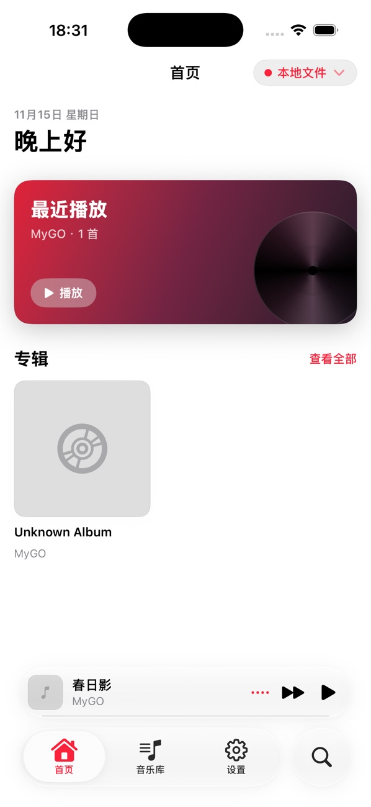
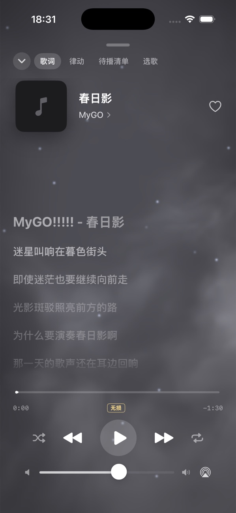

<p align="center">
  
</p>

<h1 align="center">MyGo Music iOS</h1>

<p align="center">让音乐与歌词，在掌心继续流动。</p>

<p align="center">
  <a href="https://github.com/mojieniko/mygo-music-ios/releases"></a>
  <a href="https://github.com/mojieniko/mygo-music-ios/blob/main/LICENSE"></a>
  
</p>

MyGo Music 的非官方 iOS / iPadOS 移植版。沿着熟悉的插件生态，将曲库、播放与歌词体验带到 Apple 移动设备。项目由社区独立维护，与上游没有隶属或官方合作关系。

## 特性

- **插件拓展**：通过插件接入可用的音乐来源。
- **本地曲库**：导入并播放设备中的音乐。
- **歌词体验**：在播放过程中呈现同步歌词与沉浸式视觉效果。
- **原生适配**：面向 iPhone 与 iPad，持续打磨系统界面与播放体验。

## 界面预览

<p align="center">
  
  
  
  
</p>

<p align="center"><sub>iPhone 17 Pro 模拟器 · 本地音乐界面</sub></p>

## 下载

前往 [Releases](https://github.com/mojieniko/mygo-music-ios/releases/latest) 获取最新安装包。安装包采用 Ad Hoc 签名，通常需要使用自己的开发者签名或侧载工具重新签名。最低系统版本为 iOS 17。

## 本地构建

需要 macOS 与 Xcode。

```sh
git clone https://github.com/mojieniko/mygo-music-ios.git
cd mygo-music-ios
open MyGoMusic.xcodeproj
```

在 Xcode 中选择模拟器或已配置签名的设备运行；也可使用仓库中的 `build-ipa.sh` 构建 IPA。

## 致谢与许可

本项目基于 [MyGo Music](https://github.com/egoist/mygo-music) 独立移植。iOS 版本按 [AGPL-3.0](LICENSE) 发布；上游项目的版权与许可信息请参阅其仓库。
